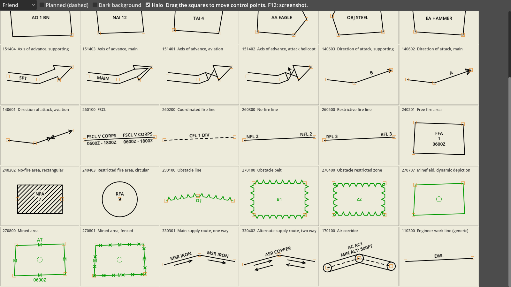

# godot-milsymbol

Military symbols (MIL-STD-2525D/E, APP-6D) and tactical graphics for Godot 4, with a 2D tactical map node.
The point symbol renderer is a GDScript port of [milsymbol](https://github.com/spatialillusions/milsymbol).

**Status:** 0.1.0, the first release. Tested with Godot 4.7.2 on Windows and Linux; plans in [ROADMAP.md](ROADMAP.md).


## Features
- **Point symbols** from number based SIDCs (20 digits): units, equipment, installations, activities, point
  control measures and the other symbol sets milsymbol supports, with frames, icons, colour modes and amplifiers
  (echelon, headquarters, task force, feint / dummy, mobility, condition, exercise / simulation).
- **Multipoint control measures** (tactical graphics): boundaries, phase lines, LD, FLOT, AO / NAI / TAI /
  assembly area / objective / engagement area, Axis of Advance, Direction of Attack, FSCL / CFL / NFL / RFL,
  FFA / NFA / RFA, obstacle lines and zones, minefields, MSR / ASR, air corridors. Drawn on any `CanvasItem` or
  written as SVG.
- **`TacticalMap2D`**: a map control with a latitude / longitude grid, pan and zoom, layers, selection and
  labels; thousands of units in one draw call per layer.
- Letter based MIL-STD-2525C SIDCs (`SFGPUCI----D---`) are converted to their 2525D equivalent and drawn.
- `MilSymbolSprite2D`, `MilSymbolSprite3D`, `MilGraphic2D` and `MilSymbolTextureRect` (UI / HUD) nodes with
  live preview in the editor.
- SVG and PNG export of symbols and control measures (labels as glyph outlines in PNG).
- Pure GDScript, no native libraries.

### Standards coverage
| | MIL-STD-2525D (incl. Change 1) | MIL-STD-2525E | APP-6D |
|---|---|---|---|
| Point symbols (every symbol set milsymbol 3.0.5 supports: 01, 02, 05, 06, 10, 11, 15, 20, 25, 27, 30, 35, 36, 40, 50–54, 60) | ✓ | ✓ | ✓ (`standard: "APP6"`) |
| Checked against milsymbol on the lists of its own test suite ([coverage](docs/coverage.md)) | 2,273 symbols, all identical | 2,179, all identical | 1,841, all identical |
| Multipoint control measures with their own geometry ([list](docs/control-measures.md)) | 76 of 271 | 73 of 302 | 93 of 286 |

Other multipoint control measure codes are drawn as a plain line or area with their designation.

**2525C letter SIDCs** are converted with Esri's legacy mapping table (1,920 entries): all warfighting (801),
signals intelligence (85) and stability operations (60) symbols, 205 of 206 emergency management symbols and 424
of 430 tactical graphics convert to a symbol that is drawn; meteorological symbols convert but are not drawn.
Symbols retired in 2525D fall back to their parent symbol. A wildcard identity (`G*GP...`) is drawn as unknown
(yellow); put the affiliation letter in the code to get friend or hostile colours. The 2525D icon is used, which
for a few symbols looks different from the 2525C one.

**SIDC versions:** like milsymbol, version digits 10–12 use the 2525D tables and 13–14 the 2525E tables; other
version digits are drawn with the 2525D tables. **APP-6(E)** (in effect since 2025-10-16) is not verified: none
of the data sources used here has an APP-6(E) table, so APP-6(E) SIDCs are drawn as 2525E / APP-6D symbols.

Not supported: letter based APP-6A/B and 2525B SIDCs (2525B codes that 2525C kept are converted); text
amplifier fields around point symbols (unique designation, higher formation, ...); the direction of movement
arrow; meteorological and oceanographic symbol sets (45–47); mission task graphics and maritime multipoint
graphics beyond the generic depiction.

## Requirements
- Godot 4.7.x, Windows or Linux tested; other versions and platforms are untested
  ([compatibility](docs/compatibility.md)). Pure GDScript, so nothing to compile.

## Installation
Download `godot-milsymbol-<version>.zip` from the [releases](https://github.com/OWNER/godot-milsymbol/releases)
and extract it into your project folder; it contains `addons/milsymbol/`. Enabling the plugin is optional; the
classes are global (`MilSymbol`, `MilGraphic`, `TacticalMap2D`, ...). From a clone, copy `addons/milsymbol/`
instead.

New to the add-on? [docs/getting-started.md](docs/getting-started.md) goes from an empty project to a map with
units and control measures in about 15 minutes.

## Usage

### Point symbols
Add a **MilSymbolSprite2D** (or **MilSymbolSprite3D**) node and set `sidc` in the inspector. The node's
position is the symbol's anchor point (frame centre, or the foot of the staff for headquarters).

```gdscript
var unit := MilSymbolSprite2D.new()
unit.sidc = "10031002161211000000"  # friendly infantry battalion HQ
unit.symbol_size = 60
unit.position = Vector2(400, 300)
add_child(unit)
```

Share a **MilSymbolStyle** resource between many symbols to change colour mode, fill, outline etc. at once.
For UI, use **MilSymbolTextureRect** (a `TextureRect`). Textures, SVG and files directly:

```gdscript
var texture := MilSymbol.create_texture("10061000001211000000", {"size": 80, "colorMode": "Dark"})
var render := MilSymbol.render("10061000001211000000")  # svg, size, anchor, metadata, valid
MilSymbol.save_png("SFGPUCI----D---", "user://platoon.png", {"size": 80})  # 2525C letter SIDC
print(MilSymbolLegacy.to_number_sidc("SFGPUCI----D---"))  # 10031000141211000000
```
Option names follow milsymbol (`size`, `colorMode`, `fill`, `frame`, `monoColor`, `outlineWidth`,
`standard`, ...). Godot's SVG loader does not draw `<text>`, so labels are drawn as outlines from bundled
Arimo glyph data (`textMode: "path"`, default); `textMode: "svg"` writes `<text>` like milsymbol.

### Control measures
```gdscript
# Friendly phase line "PL BLUE" through two points (pixels, y down).
var shape := MilGraphic.build("10032500001403000000", PackedVector2Array([Vector2(0, 0), Vector2(300, 20)]),
		{"T": "BLUE"})

func _draw() -> void:
	MilGraphicRenderer.draw(self, shape)
```
Or use a **MilGraphic2D** node. `MilGraphicRenderer.save_svg()` / `save_png()` write files. Point order, amplifiers and colours: [docs/control-measures.md](docs/control-measures.md).

### Tactical map
```gdscript
var map := TacticalMap2D.new()
map.set_anchors_preset(Control.PRESET_FULL_RECT)
add_child(map)
map.center_on(39.93, 32.86, 50.0)  # latitude, longitude, metres per pixel
map.add_unit("A", "10031000151211000000", 39.94, 32.85, "A COY")
map.add_graphic("OBJ", "10032500001517000000", PackedVector2Array(
		[Vector2(32.90, 39.95), Vector2(32.95, 39.95), Vector2(32.95, 39.92)]), {"T": "STEEL"})
```
API, coordinates and performance: [docs/tactical-map.md](docs/tactical-map.md).

## Demos
Open the project in Godot and press F5 (`demo/main.tscn`). Tabs:
- **Tactical map**: a fictional brigade attack with units and control measures. Keys: G grid, 1–4 layers,
  M movement, N 5,000-unit stress test, F fit, L labels, D light / dark, F12 screenshot.
- **Frames**, **Icons**: frame and icon browsers.
- **Sprites 2D**, **Map 3D**: `MilSymbolSprite2D` / `MilSymbolSprite3D` scenes.
- **Control measures**: every control measure with its own geometry; drag the control points.



## Documentation
- [docs/getting-started.md](docs/getting-started.md): first map in 15 minutes
- [docs/tactical-map.md](docs/tactical-map.md): `TacticalMap2D`
- [docs/control-measures.md](docs/control-measures.md): multipoint control measures
- [docs/coverage.md](docs/coverage.md): point symbol coverage per standard and symbol set
- [docs/compatibility.md](docs/compatibility.md): tested Godot versions and platforms
- [docs/draw-instructions.md](docs/draw-instructions.md): milsymbol internals used by the port
- [docs/media.md](docs/media.md): README pictures and how they are made
- [ROADMAP.md](ROADMAP.md): what comes next
- [CHANGELOG.md](CHANGELOG.md)

## Development
Godot 4.7.x. Node.js is only needed for the data export tools in `tools/export/`.

```sh
# Tests (GUT), headless
godot --headless --path . --import
godot --headless --path . -s addons/gut/gut_cmdln.gd

# Regenerate data and reference output from milsymbol and the standards data packages
cd tools/export && npm ci
npm run data && npm run icons && npm run glyphs && npm run control-measures && npm run legacy
npm run golden && npm run golden:bulk && npm run coverage

# Reports and control measure regression SVGs
godot --headless --path . -s res://tools/coverage_report.gd
godot --headless --path . -s res://tools/control_measures_report.gd
godot --headless --path . -s res://tools/graphics_golden.gd

# Release zip (addons/milsymbol + LICENSE + notices), checked in a new empty project
python tools/package_addon.py
python tools/check_package.py build/package/godot-milsymbol-<version>.zip --godot <path to Godot>

# README GIF, social preview and icon (Pillow; opens a window)
python tools/capture_media.py --godot <path to Godot>

# Screenshots and frame statistics of the map demo
godot --path . res://demo/tactical_map.tscn -- --screenshot map.png
godot --path . --disable-vsync res://demo/tactical_map.tscn -- --stress 5000 --seconds 8
```

## Contributing
Bug reports, questions and pull requests are welcome. Please read [CONTRIBUTING.md](CONTRIBUTING.md) and the
[code of conduct](CODE_OF_CONDUCT.md).

## License
MIT. Includes data derived from milsymbol and its standards data packages (MIT), glyph outlines from the
Arimo font (OFL 1.1, `addons/milsymbol/LICENSE-OFL-1.1.txt`) and the 2525C to 2525D mapping from Esri
joint-military-symbology-xml (Apache-2.0, `addons/milsymbol/LICENSE-APACHE-2.0.txt`); control measure shapes
follow mil-sym-ts (Apache-2.0) as a reference. Commercial use is allowed under these licences; keep the
licence files of `addons/milsymbol/` with the add-on. See [THIRD_PARTY_NOTICES.md](THIRD_PARTY_NOTICES.md).
