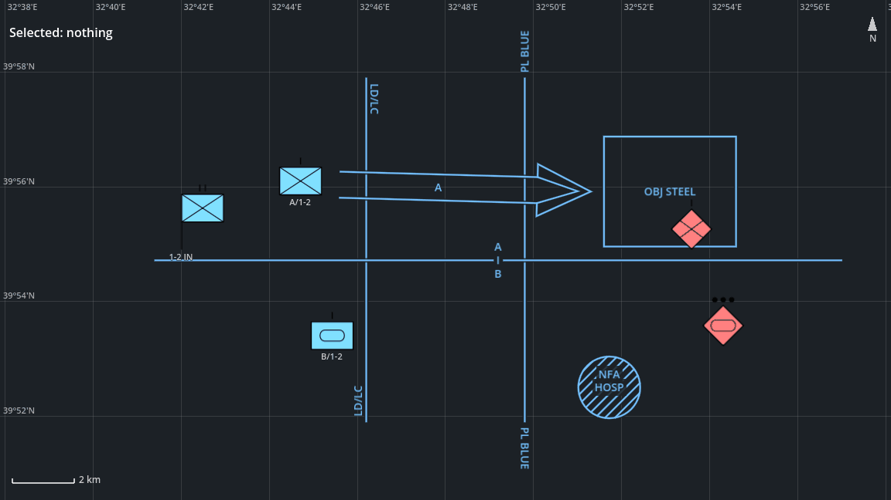

# Getting started

From an empty Godot project to a tactical map with units and control measures, in about 15 minutes. You need
**Godot 4.7.x** (the standard build; the .NET build works too) and the add-on zip. No programming beyond
copying one script is needed.



## 1. Create a project (1 minute)

Start Godot. In the Project Manager click **Create**, give the project a name (for example `my-tactical-map`),
choose a folder, keep the default renderer and click **Create**. The editor opens.

Command line alternative: an empty folder with a `project.godot` file containing only `config_version=5` is
a valid project.

## 2. Install the add-on (2 minutes)

1. Download `godot-milsymbol-<version>.zip` from the
   [releases page](https://github.com/OWNER/godot-milsymbol/releases).
2. Extract it into the **project folder** (the folder with `project.godot`). The zip already contains the
   `addons/` folder, so afterwards you have:

   ```
   my-tactical-map/
   ├── project.godot
   └── addons/
       └── milsymbol/
           ├── plugin.cfg
           ├── milsymbol.gd
           └── ...
   ```

   If you get `addons/milsymbol/addons/...` or `godot-milsymbol-<version>/addons/...`, move the folders so the
   layout matches the one above.
3. Go back to the editor. It scans the new files on its own; if it does not, use **Project > Reload Current
   Project**. Without the editor, run `godot --headless --path my-tactical-map --import` once instead: it
   registers the add-on's classes (`godot` stands for your Godot executable).
4. Optional: **Project > Project Settings > Plugins**, enable **milsymbol**. The classes (`MilSymbol`,
   `MilGraphic`, `TacticalMap2D`, ...) work without it; the plugin only adds node icons in the editor.

## 3. A first symbol, without code (2 minutes)

1. **Scene > New Scene**, choose **2D Scene** as root.
2. Add a child node (**Ctrl+A**), search for **MilSymbolSprite2D**, add it.
3. In the Inspector set **Sidc** to `10031000161211000000`. A friendly infantry battalion symbol (blue
   rectangle with a cross and two bars) appears in the viewport. Try `10061000161211000000` (hostile, red
   diamond).

`MilSymbolSprite2D` is a `Sprite2D` with a `sidc` property, so in code it is
`var unit := MilSymbolSprite2D.new()` and `unit.sidc = "10031000161211000000"`. This scene is not needed for the
rest of the guide; you can close it without saving.

### Reading a SIDC

The 20-digit codes are MIL-STD-2525D/E and APP-6D symbol identification codes. The digits that matter here:

| Digits | Meaning | Values used in this guide |
|---|---|---|
| 1–2 | Version | `10` (2525D) |
| 4 | Standard identity | `3` friend, `6` hostile (`4` neutral, `1` unknown) |
| 5–6 | Symbol set | `10` land unit, `25` control measure |
| 8 | Headquarters / task force / dummy | `2` headquarters |
| 9–10 | Echelon | `14` platoon, `15` company, `16` battalion |
| 11–16 | Entity | `121100` infantry, `120500` armour, `140300` phase line, ... |

Letter codes from MIL-STD-2525C (`SFGPUCI----D---`) work too; they are converted to the 2525D code.

## 4. The tactical map (5 minutes)

1. **Scene > New Scene**, choose **User Interface** as root. A `Control` node fills the window.
2. Rename it to `Main` (double-click the node).
3. Right-click `Main` > **Attach Script**, keep the defaults (`res://main.gd`, inherits `Control`), click
   **Create**.
4. Replace the whole script with:

```gdscript
extends Control

var map: TacticalMap2D
var info: Label
var _time := 0.0


func _ready() -> void:
	map = TacticalMap2D.new()
	map.set_anchors_preset(Control.PRESET_FULL_RECT)
	add_child(map)
	map.center_on(39.915, 32.80, 25.0)  # latitude, longitude, metres per pixel

	# Layers are drawn in the order they are added: control measures under the units.
	map.add_layer("Control measures")
	map.add_layer("Friendly")
	map.add_layer("Hostile")

	# Units: id, SIDC, latitude, longitude, label, layer.
	map.add_unit("HQ", "10031002161211000000", 39.915, 32.700, "1-2 IN", "Friendly")
	map.add_unit("A", "10031000151211000000", 39.935, 32.745, "A/1-2", "Friendly")
	map.add_unit("B", "10031000151205000000", 39.890, 32.745, "B/1-2", "Friendly")
	map.add_unit("E1", "10061000151211000000", 39.921, 32.893, "", "Hostile")
	map.add_unit("E2", "10061000141205000000", 39.893, 32.905, "", "Hostile")

	# Control measures: points are Vector2(longitude, latitude).
	var cm := "Control measures"
	map.add_graphic("LD", "10032500001411000000",
			PackedVector2Array([Vector2(32.77, 39.965), Vector2(32.77, 39.865)]), {}, cm)
	map.add_graphic("PL BLUE", "10032500001403000000",
			PackedVector2Array([Vector2(32.83, 39.965), Vector2(32.83, 39.865)]), {"T": "BLUE"}, cm)
	map.add_graphic("BDY", "10032500151101000000",
			PackedVector2Array([Vector2(32.69, 39.912), Vector2(32.95, 39.912)]), {"T": "A", "T1": "B"}, cm)
	map.add_graphic("OBJ", "10032500001517000000", PackedVector2Array([Vector2(32.86, 39.948),
			Vector2(32.91, 39.948), Vector2(32.91, 39.916), Vector2(32.86, 39.916)]), {"T": "STEEL"}, cm)
	map.add_graphic("AXIS", "10032500001514030000", PackedVector2Array([Vector2(32.855, 39.932),
			Vector2(32.76, 39.934), Vector2(32.835, 39.940)]), {"T": "A"}, cm)
	map.add_graphic("NFA", "10032500002403030000", PackedVector2Array([Vector2(32.862, 39.875)]),
			{"T": "HOSP", "AM": 1000.0}, cm)

	info = Label.new()
	info.position = Vector2(12, 30)
	add_child(info)
	map.selection_changed.connect(_on_selection_changed)
	_on_selection_changed([])


func _process(delta: float) -> void:
	_time += delta
	# B company moves east and back (in a simulation: the position from your model or the network).
	map.move_unit("B", 39.890, 32.745 + pingpong(_time * 0.004, 0.06))


func _on_selection_changed(ids: Array) -> void:
	info.text = "Selected: %s" % (", ".join(ids.map(str)) if not ids.is_empty() else "nothing")
```
   The code is indented with tabs; if you type it instead of pasting, use tabs too (GDScript does not accept
   a mix of tabs and spaces).
5. Save the scene (**Ctrl+S**) as `res://main.tscn`.
6. Press **F5** (Run Project). Godot asks for a main scene: click **Select Current**.

Without the editor, steps 1–6 are three files in the project folder: `main.gd` with the script above,
`main.tscn` with

```
[gd_scene format=3]

[ext_resource type="Script" path="res://main.gd" id="1"]

[node name="Main" type="Control"]
anchors_preset = 15
anchor_right = 1.0
anchor_bottom = 1.0
script = ExtResource("1")
```

and these lines added to `project.godot`; then run `godot --path my-tactical-map`:

```
[application]
run/main_scene="res://main.tscn"
```

You see the picture at the top of this page: a battalion headquarters and two companies behind a line of
departure / line of contact (LD/LC), an axis of advance through phase line BLUE to objective STEEL, the
boundary between A and B company, a no-fire area around a hospital and two enemy units. B company moves.

What the calls mean:
- `add_unit(id, sidc, latitude, longitude, label, layer)` adds a symbol; `move_unit(id, latitude, longitude)`
  moves it and is cheap enough to call every frame for thousands of units.
- `add_graphic(id, sidc, points, amplifiers, layer)` adds a control measure. **Points are
  `Vector2(longitude, latitude)`** (x east, y north), unlike `add_unit`, which takes latitude first.
- Amplifiers: `T` is the name ("BLUE", "STEEL"), `T1` the second name of a boundary, `AM` a distance in metres
  (the radius of a circular fire area). The axis of advance takes the arrow tip first, then the centreline
  back to the rear, then one point that sets the arrowhead width.

## 5. Use the map (2 minutes)

| Input | Action |
|---|---|
| Mouse wheel | Zoom at the cursor |
| Left-drag | Pan |
| Click a unit | Select it (the label shows its id) |
| Shift- or Ctrl-click | Add or remove a unit from the selection |
| Shift-drag on empty map | Box selection |
| Arrow keys, + / - | Pan and zoom (click the map first) |

The grid shows latitude and longitude, the bar at the bottom left the scale, the arrow at the top right
north, and the bottom right corner the latitude and longitude under the mouse cursor.

## 6. Check it from the command line (optional)

To check a project without opening a window (for example on a build server), import once and run the main
scene headless for a few hundred frames; no `ERROR` or `SCRIPT ERROR` line should appear:

```sh
godot --headless --path my-tactical-map --import
godot --headless --path my-tactical-map --quit-after 300
```

(`godot` stands for your Godot executable, for example `Godot_v4.7.2-stable_linux.x86_64` or
`Godot_v4.7.2-stable_win64_console.exe`.)

## Troubleshooting

| Problem | Cause and fix |
|---|---|
| `Identifier "TacticalMap2D" not declared in the current scope` | The editor has not scanned the add-on yet, or it is in the wrong folder. Check that `res://addons/milsymbol/plugin.cfg` exists, then **Project > Reload Current Project** (command line: run `--import` once). |
| A unit is missing or drawn as a plain frame | The SIDC is not valid or has the wrong length. `print(MilSymbol.render(sidc).valid)` tells you. |
| A control measure is far away or missing | Points swapped: `add_graphic` takes `Vector2(longitude, latitude)`. |
| The map is empty / zero size | The map control has no size. Use `set_anchors_preset(Control.PRESET_FULL_RECT)` under a full-window `Control`, or put it in a container. |
| Labels overlap at small zoom | Labels are hidden automatically when more than `label_limit` units are on screen; set `show_labels = false` to hide them always. |

## Next steps

- [tactical-map.md](tactical-map.md): all `TacticalMap2D` methods, signals, coordinates and performance.
- [control-measures.md](control-measures.md): every control measure code, point order and amplifier.
- The demo project in this repository (`demo/main.tscn`) shows a brigade-size scenario, a 5,000-unit stress
  test, a control measure gallery and 3D sprites.
- Symbols outside a map: `MilSymbolSprite2D`, `MilSymbolSprite3D` (billboards in 3D), `MilSymbolTextureRect`
  (UI) and `MilSymbol.save_png()` / `save_svg()`; see the README.
