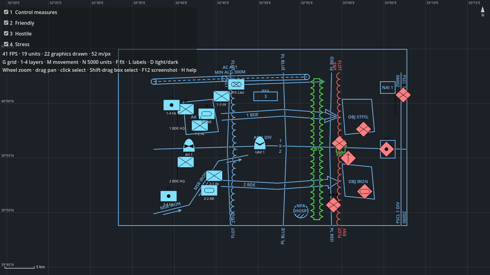

# TacticalMap2D

A `Control` that shows units (military symbols) and control measures on a 2D map. Add it to any UI, give it a
size (anchors or a container) and feed it geographic positions.



```gdscript
var map := TacticalMap2D.new()
map.set_anchors_preset(Control.PRESET_FULL_RECT)
add_child(map)
map.center_on(39.93, 32.86, 50.0)  # latitude, longitude, ground metres per pixel

map.add_layer("Friendly")
map.add_unit("1-2 IN", "10031000161211000000", 39.95, 32.70, "1-2 IN", "Friendly")
map.move_unit("1-2 IN", 39.951, 32.705)  # every frame or whenever an update arrives

# Control measures: x = longitude, y = latitude; distances (AM) in metres.
map.add_graphic("PL BLUE", "10032500001403000000",
		PackedVector2Array([Vector2(32.80, 40.05), Vector2(32.81, 39.80)]), {"T": "BLUE"})
map.add_graphic("NFA 1", "10032500002403030000", PackedVector2Array([Vector2(32.9, 39.9)]), {"AM": 1200.0})

map.selection_changed.connect(func(ids: Array) -> void: print(ids))
```

## Coordinates

- Positions are WGS84 latitude / longitude in degrees. The map uses the spherical Web Mercator projection
  (EPSG:3857), the same as web map tiles; north is up and meridians are vertical.
- `meters_per_pixel` is the ground resolution at the map centre. The Mercator scale is kept while panning, so
  this value changes with the centre latitude; `meters_per_pixel_at(latitude)` gives it for any latitude.
- `lat_lon_to_screen(latitude, longitude) -> Vector2` and `screen_to_lat_lon(position) -> PackedFloat64Array`
  convert to and from the control's local pixels. Internally positions are kept relative to a plane origin
  that follows the view (it moves when the centre is more than 1,000 km away), so 32-bit `Vector2` precision
  is not a problem anywhere. Longitudes are taken within ±180° of that origin: the map works across the
  antimeridian (`zoom_to_content()` and `zoom_to()` expect a box that does not cross it).

## Units

| Method | |
|---|---|
| `add_unit(id, sidc, latitude, longitude, label = "", layer = "default")` | Adds or replaces. `id` is any Dictionary key (int, String, ...). |
| `move_unit(id, latitude, longitude)` | Cheap: updates one MultiMesh instance. |
| `set_unit_sidc(id, sidc)`, `set_unit_label(id, label)`, `remove_unit(id)`, `clear_units()` | |
| `get_unit(id) -> Dictionary`, `has_unit(id)`, `get_unit_ids()`, `get_unit_count()` | |
| `unit_at(position)` | Topmost unit under a screen position, or null. |
| `select_units(ids, add = false)`, `get_selected_units()` | |

Symbols use `symbol_size` and the shared `symbol_style` (`MilSymbolStyle`). Labels are drawn under the symbols
while at most `label_limit` units are on screen (and the map has at most 10 × `label_limit` units).

## Control measures

`add_graphic(id, sidc, points, amplifiers = {}, layer = "default")`, `remove_graphic`, `clear_graphics`,
`get_graphic_shape(id)`. Graphics are rebuilt in screen space (`MilGraphic.build`) when the view changes and
culled when off screen. Colours come from `graphic_palette` (`MilGraphicRenderer.PALETTE_DARK_MAP` by default,
`PALETTE_LIGHT_MAP` for light backgrounds). Point order and amplifiers: [control-measures.md](control-measures.md).

## Layers

`add_layer(name)` adds a layer on top; `set_layer_visible(name, visible)`, `is_layer_visible`,
`get_layer_names()`. Each layer draws its control measures under its units; later layers are on top. Hidden
layers are not hit by clicks and their units leave the selection. A `"default"` layer always exists.

## Input and signals

- Mouse wheel: zoom at the cursor. Left-drag on the map: pan. Click a unit: select it; Shift- or Ctrl-click: add
  or remove it; Shift-drag from empty map: box selection. Arrow keys and +/- when the map has focus.
- Signals: `unit_selected(id)`, `selection_changed(ids)`, `unit_hovered(id)` (null when leaving),
  `map_clicked(latitude, longitude, button_index)` (left click on empty map, right click anywhere),
  `view_changed`.
- Other properties: `background_color`, `grid_visible`, `grid_color`, `text_color`, `selection_color`,
  `graphic_line_width`, `show_labels`, `min_meters_per_pixel`, `max_meters_per_pixel`. `zoom_to(...)` and
  `zoom_to_content()` fit a box or everything on the map.

There is no background map (tiles or imagery); the background is a colour with a latitude / longitude grid.
Put a `TextureRect` or your own drawing behind a map with a transparent `background_color` if you need one.

## How it draws

Every distinct symbol (SIDC + options) is rendered once by `MilSymbol` and packed into a `MilSymbolAtlas`
texture, padded so that its anchor point is at the centre of its region. Each layer has one
`MultiMeshInstance2D` whose instances carry the plane position, the symbol size and the atlas region. The layer
node is scaled and moved by the view; a small canvas shader divides the quad by the zoom so that symbols keep
their pixel size. Panning and zooming therefore touch no instances, and a moving unit updates one instance.

## Performance

`demo/tactical_map.tscn` with `-- --stress <n> --seconds 8`, vsync off (`--disable-vsync`), 1600 × 900 window,
Godot 4.7.2, Windows 11, Ryzen 9 7950X, RTX 4080. Average frame time over the run:

| Extra units | Static (`--static`) | Every unit moves every frame |
|---:|---:|---:|
| 0 (19 demo units) | – | 0.47 ms |
| 5,000 | 0.32 ms | 8.6 ms |
| 20,000 | 0.33 ms | 42 ms |

Drawing is not the limit; the cost of moving units is the GDScript call per unit (about 1.7–2 µs). Simulations
rarely update every unit every frame (for example DIS entities send a few updates per second and are dead
reckoned in between).

## Using it with godot-dis

The map has no dependency on godot-dis. With both add-ons in a project, call `add_unit` / `move_unit` /
`remove_unit` for the entities godot-dis tracks (`DisEntityManager`), with the SIDC from
`DisEnums.entity_type_to_sidc()` and the entity's geodetic position.
